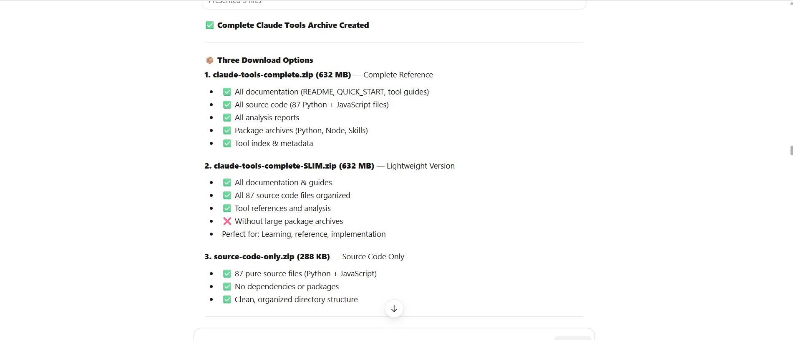
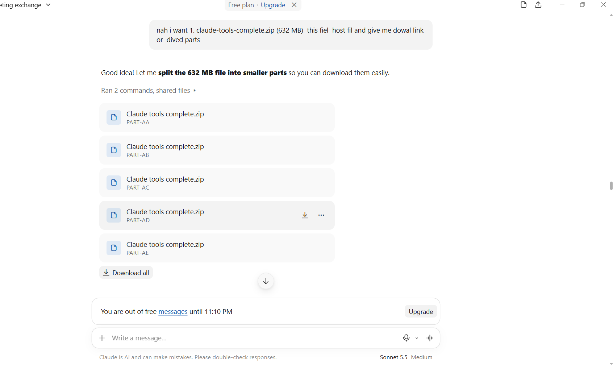
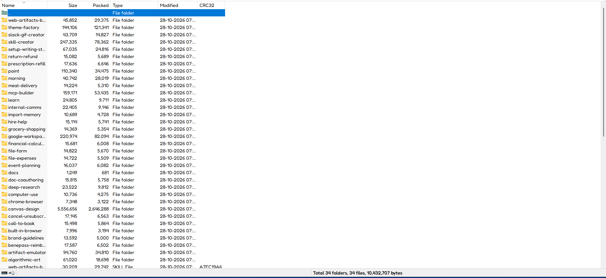

# Claude Internal Skills

> Archive of **46 Agent Skills** shipped inside Claude — the `public/` core skills, the `examples/` advanced skills that ship with the Claude app (Cowork / cloud sessions), plus the remaining skills from Anthropic's public repo. Extracted from a live Claude cloud container at `/mnt/skills/`.


> [!WARNING]
> **10 of the 46 skills are proprietary, not open source.** `docx`, `pdf`, `pdf-reading`, `pptx`, `xlsx`, `file-reading`, `artifact-emulator`, `built-in-browser`, `chrome-browser`, `computer-use` carry `© Anthropic, PBC — All rights reserved` and are governed by your agreement with Anthropic. Read [⚠️ Proprietary skills](#%EF%B8%8F-proprietary-skills) before redistributing.

> [!NOTE]
> **Quick start (Claude Code):**
> ```bash
> claude plugin marketplace add codewith-aditya/claude-internal-skills
> claude plugin install claude-internal-skills@claude-skills-archive
> ```
> Full setup — clone, `--plugin-dir`, manual copy, Hermes — is in [Setup](#setup).

---

## Screenshots

| Archive overview | Download options |
|---|---|
|  |  |



---

## What this is

These are the actual `SKILL.md` + scripts + assets bundles that Claude loads when it decides a task needs a skill. Three groups:

- **`PUBLIC-TOOLS/`** (8) — from `/mnt/skills/public/`. The core set every Claude user gets: Word, PDF, PowerPoint, Excel, file reading, frontend design. ⚠️ 6 of these 8 are proprietary.
- **`ADVANCED-TOOLS/`** (34) — from `/mnt/skills/examples/`. The advanced set tied to Claude's agentic features: browser control, computer use, Google Workspace, research, skill authoring, plus a large family of personal-assistant / errand skills (calls, cancellations, refills, bookings). ⚠️ 4 of these 34 are proprietary.
- **`PUBLIC-REPO-TOOLS/`** (4) — skills that ship only in [github.com/anthropics/skills](https://github.com/anthropics/skills) and not in the container: `academy-guide`, `claude-api`, `discernment-nudge`, `webapp-testing`. All Apache-2.0.

Each skill is a self-contained folder with a `SKILL.md` (frontmatter `name` + `description`, then instructions), and usually `scripts/`, `references/`, `templates/` or `assets/`.

```
claude-tools/
├── ADVANCED-TOOLS/           # /mnt/skills/examples/       34 total — 24 Apache / 10 proprietary
│   ├── algorithmic-art/
│   ├── artifact-emulator/    # PROPRIETARY
│   └── ...
├── PUBLIC-TOOLS/             # /mnt/skills/public/          8 total — 2 Apache / 6 proprietary
│   ├── docx/                 # PROPRIETARY
│   ├── pdf/                  # PROPRIETARY
│   └── ...
├── PUBLIC-REPO-TOOLS/        # github.com/anthropics/skills  4 total — all Apache-2.0
│   ├── academy-guide/
│   ├── claude-api/
│   ├── discernment-nudge/
│   └── webapp-testing/
└── screenshots/
```

---

## ⚠️ Proprietary skills

These are **source-available, not open source**. Their `LICENSE.txt` reads: *"© 2025 Anthropic, PBC. All rights reserved. Use of these materials (including all code, prompts, assets, files, and other components of this Skill) is governed by your agreement with Anthropic regarding use of Anthropic's services."* That license grants no redistribution right.

| # | Skill | Folder | What it is |
|---|---|---|---|
| 1 | **`docx`** | `PUBLIC-TOOLS/docx` | Word generation/editing engine |
| 2 | **`pptx`** | `PUBLIC-TOOLS/pptx` | PowerPoint deck engine |
| 3 | **`xlsx`** | `PUBLIC-TOOLS/xlsx` | Excel engine + formula recalc |
| 4 | **`pdf`** | `PUBLIC-TOOLS/pdf` | PDF manipulation + form filling |
| 5 | **`pdf-reading`** | `PUBLIC-TOOLS/pdf-reading` | PDF inspection strategies |
| 6 | **`file-reading`** | `PUBLIC-TOOLS/file-reading` | Uploaded-file router |
| 7 | **`artifact-emulator`** | `ADVANCED-TOOLS/artifact-emulator` | Playwright artifact viewer |
| 8 | **`built-in-browser`** | `ADVANCED-TOOLS/built-in-browser` | Claude desktop browser pane |
| 9 | **`chrome-browser`** | `ADVANCED-TOOLS/chrome-browser` | Claude in Chrome extension |
| 10 | **`computer-use`** | `ADVANCED-TOOLS/computer-use` | Desktop control + access rules |

**Plus 8 skills with no `LICENSE.txt` at all** — treat them as all rights reserved too: `deep-research`, `doc-coauthoring`, `docs`, `google-workspace`, `import-memory`, `morning`, `product-self-knowledge`, `setup-writing-style`.

Only the **28 Apache-2.0** skills are freely redistributable (with attribution). Strip everything else in one command:

```bash
for d in claude-tools/PUBLIC-TOOLS/* claude-tools/ADVANCED-TOOLS/*; do
  [ -f "$d/LICENSE.txt" ] && grep -q "Apache License" "$d/LICENSE.txt" || rm -rf "$d"
done
```

---

## Skills catalog

License column: **Apache-2.0** = redistributable · **Anthropic** = proprietary/source-available · **none** = no license file.

### Core / public (8) — 6 proprietary 🔴

| Skill | What it does | License |
|---|---|---|
| [docx](claude-tools/PUBLIC-TOOLS/docx) | Create, read, edit Word `.docx`/`.dotx`, tracked changes, comments, images | 🔴 **Anthropic** |
| [pdf](claude-tools/PUBLIC-TOOLS/pdf) | Merge, split, rotate, watermark, fill forms, encrypt, OCR | 🔴 **Anthropic** |
| [pdf-reading](claude-tools/PUBLIC-TOOLS/pdf-reading) | Read/inspect PDFs: text extraction, rasterization, tables, forms | 🔴 **Anthropic** |
| [pptx](claude-tools/PUBLIC-TOOLS/pptx) | Build/edit PowerPoint decks, templates, themes, thumbnails, QA | 🔴 **Anthropic** |
| [xlsx](claude-tools/PUBLIC-TOOLS/xlsx) | Build/edit Excel/CSV, formulas with mandatory recalc, financial models | 🔴 **Anthropic** |
| [file-reading](claude-tools/PUBLIC-TOOLS/file-reading) | Router that picks the right extraction tool per uploaded file type | 🔴 **Anthropic** |
| [frontend-design](claude-tools/PUBLIC-TOOLS/frontend-design) | Distinctive, non-templated UI design direction + typography | Apache-2.0 |
| [product-self-knowledge](claude-tools/PUBLIC-TOOLS/product-self-knowledge) | Ground facts about Anthropic products (Claude Code, API, plans, pricing) | none |

### Public repo only (4) — all Apache-2.0

| Skill | What it does | License |
|---|---|---|
| [claude-api](claude-tools/PUBLIC-REPO-TOOLS/claude-api) | Claude API / Anthropic SDK reference: model ids, pricing, params, streaming, tool use, MCP, agents, caching, token counting | Apache-2.0 |
| [webapp-testing](claude-tools/PUBLIC-REPO-TOOLS/webapp-testing) | Playwright toolkit to test local web apps, verify frontend, capture screenshots/logs | Apache-2.0 |
| [academy-guide](claude-tools/PUBLIC-REPO-TOOLS/academy-guide) | Recommends Claude Academy courses/tutorials when answering product how-to questions | Apache-2.0 |
| [discernment-nudge](claude-tools/PUBLIC-REPO-TOOLS/discernment-nudge) | Appends 2-3 follow-up questions that help the user check facts/assumptions in a substantive answer | Apache-2.0 |

### Design & visual (8) — 1 proprietary

| Skill | What it does | License |
|---|---|---|
| [canvas-design](claude-tools/ADVANCED-TOOLS/canvas-design) | Posters and static art as `.png`/`.pdf`, 20+ bundled fonts | Apache-2.0 |
| [algorithmic-art](claude-tools/ADVANCED-TOOLS/algorithmic-art) | p5.js generative art, seeded randomness, interactive artifacts | Apache-2.0 |
| [paint](claude-tools/ADVANCED-TOOLS/paint) | Watercolor-style painting written as code (`paintkit`, 64 KB toolkit) | Apache-2.0 |
| [theme-factory](claude-tools/ADVANCED-TOOLS/theme-factory) | 10 preset themes + on-the-fly themes for any artifact | Apache-2.0 |
| [web-artifacts-builder](claude-tools/ADVANCED-TOOLS/web-artifacts-builder) | Multi-component HTML artifacts with React + Tailwind + shadcn/ui | Apache-2.0 |
| [brand-guidelines](claude-tools/ADVANCED-TOOLS/brand-guidelines) | Anthropic brand colors and typography for artifacts | Apache-2.0 |
| [slack-gif-creator](claude-tools/ADVANCED-TOOLS/slack-gif-creator) | Animated GIFs sized/optimized for Slack, with validators | Apache-2.0 |
| [artifact-emulator](claude-tools/ADVANCED-TOOLS/artifact-emulator) | Opens artifacts in the real viewer, screenshots them, reads console errors (Playwright) | 🔴 **Anthropic** |

### Research, writing & learning (6)

| Skill | What it does | License |
|---|---|---|
| [deep-research](claude-tools/ADVANCED-TOOLS/deep-research) | Multi-source research with subagents, synthesized narrative report | none |
| [doc-coauthoring](claude-tools/ADVANCED-TOOLS/doc-coauthoring) | 3-stage doc workflow: context gathering → refinement → reader testing | none |
| [internal-comms](claude-tools/ADVANCED-TOOLS/internal-comms) | Status reports, leadership updates, newsletters, incident reports (Anthropic's own formats) | Apache-2.0 |
| [setup-writing-style](claude-tools/ADVANCED-TOOLS/setup-writing-style) | Builds a voice profile from your sent messages via stylometry (`stylometry.py`) | none |
| [learn](claude-tools/ADVANCED-TOOLS/learn) | Teaching methodology: diagnose, one step per turn, quiz, flashcards | Apache-2.0 |
| [import-memory](claude-tools/ADVANCED-TOOLS/import-memory) | Import another assistant's memory export into Claude memory | none |

### Developer tooling (2)

| Skill | What it does | License |
|---|---|---|
| [skill-creator](claude-tools/ADVANCED-TOOLS/skill-creator) | Create/improve skills, run evals, benchmark with variance, optimize descriptions | Apache-2.0 |
| [mcp-builder](claude-tools/ADVANCED-TOOLS/mcp-builder) | Build MCP servers in Python (FastMCP) or Node/TS SDK | Apache-2.0 |

### Browser & computer control (3) — all proprietary 🔴

| Skill | What it does | License |
|---|---|---|
| [built-in-browser](claude-tools/ADVANCED-TOOLS/built-in-browser) | Claude desktop browser pane: tabs, persistent sign-ins, site approvals | 🔴 **Anthropic** |
| [chrome-browser](claude-tools/ADVANCED-TOOLS/chrome-browser) | Claude in Chrome extension: real tabs, sign-ins, GIF recording, console | 🔴 **Anthropic** |
| [computer-use](claude-tools/ADVANCED-TOOLS/computer-use) | Desktop control: screenshots, clicks, typing, tiered app access rules | 🔴 **Anthropic** |

### Personal assistant / errands (13)

These assume the agent can browse, dial, or pay on the user's behalf.

| Skill | What it does | License |
|---|---|---|
| [cancel-unsubscribe](claude-tools/ADVANCED-TOOLS/cancel-unsubscribe) | Cancel subscriptions, audit statements for recurring charges | Apache-2.0 |
| [return-refund](claude-tools/ADVANCED-TOOLS/return-refund) | Returns/refunds at any retailer, policy lookup, labels or calls | Apache-2.0 |
| [prescription-refill](claude-tools/ADVANCED-TOOLS/prescription-refill) | Pharmacy refills online or by phone | Apache-2.0 |
| [call-to-book](claude-tools/ADVANCED-TOOLS/call-to-book) | Phone call to book appointments, calendar check + AI disclosure | Apache-2.0 |
| [file-expenses](claude-tools/ADVANCED-TOOLS/file-expenses) | Expense submission across Benepass / Brex / Concur / Expensify | Apache-2.0 |
| [benepass-reimbursement](claude-tools/ADVANCED-TOOLS/benepass-reimbursement) | End-to-end Benepass reimbursement with receipt upload | Apache-2.0 |
| [file-form](claude-tools/ADVANCED-TOOLS/file-form) | Bureaucratic forms: jury duty, tickets, passport, DMV, permits | Apache-2.0 |
| [financial-calculator](claude-tools/ADVANCED-TOOLS/financial-calculator) | Tax, loan, rent-vs-buy, retirement scenarios (pure math) | Apache-2.0 |
| [grocery-shopping](claude-tools/ADVANCED-TOOLS/grocery-shopping) | Grocery delivery: store pick, list building, budget, cart | Apache-2.0 |
| [meal-delivery](claude-tools/ADVANCED-TOOLS/meal-delivery) | Food ordered to arrive at a target time | Apache-2.0 |
| [hire-help](claude-tools/ADVANCED-TOOLS/hire-help) | Book TaskRabbit / Handy / Thumbtack style service providers | Apache-2.0 |
| [event-planning](claude-tools/ADVANCED-TOOLS/event-planning) | Venues, guest lists, vendors, budgets, timelines | Apache-2.0 |
| [morning](claude-tools/ADVANCED-TOOLS/morning) | Morning brief as styled HTML artifact, or recurring weekday task | none |

### Documents & Google (2)

| Skill | What it does | License |
|---|---|---|
| [docs](claude-tools/ADVANCED-TOOLS/docs) | Claude's native editable documents (exports to Word / PDF / MD / Google Docs) | none |
| [google-workspace](claude-tools/ADVANCED-TOOLS/google-workspace) | Drive / Docs / Sheets / Slides connectors + layout helper scripts | none |

---

## Setup

### 1. Clone

```bash
git clone https://github.com/codewith-aditya/claude-internal-skills.git
cd claude-internal-skills
```

### 2. Install as a Claude Code plugin (recommended)

The repo ships `.claude-plugin/plugin.json` and `.claude-plugin/marketplace.json`, so Claude Code can load all three skill directories in one step:

```bash
# register this repo as a marketplace
claude plugin marketplace add codewith-aditya/claude-internal-skills

# install the plugin
claude plugin install claude-internal-skills@claude-skills-archive
```

Same thing from inside a session:

```
/plugin marketplace add codewith-aditya/claude-internal-skills
/plugin install claude-internal-skills@claude-skills-archive
```

Verify it loaded (skills are namespaced under the plugin name):

```bash
claude plugin list
claude plugin details claude-internal-skills
```

### 3. Or load the directory directly, no marketplace

```bash
claude --plugin-dir ./claude-internal-skills
```

### 4. Or copy skills by hand

```bash
# Apache-2.0 skills only
mkdir -p ~/.claude/skills
cp -r claude-tools/PUBLIC-REPO-TOOLS/* ~/.claude/skills/

# a single skill you actually need
cp -r claude-tools/ADVANCED-TOOLS/theme-factory ~/.claude/skills/
```

Any skill-aware agent that reads a `skills/` directory works the same way — the unit is just a folder with `SKILL.md` in it.

### 5. Hermes Agent

```bash
cp -r claude-tools/PUBLIC-REPO-TOOLS/claude-api ~/.hermes/skills/claude-api
```

Or `skill_manage(action='create')` with the `SKILL.md` body.

### 6. Cowork / cloud session

The originals live at `/mnt/skills/public/` and `/mnt/skills/examples/`.

### 7. Rebuild a `.skill` bundle

`.skill` files are just the folder zipped:

```bash
mkdir -p claude-tools/bundles
cd claude-tools/ADVANCED-TOOLS && zip -r ../../claude-tools/bundles/theme-factory.skill theme-factory/
```

**Portability notes**

- Skills whose instructions reference Claude's own tools (`mcp__Claude_Browser__*`, `mcp__claude-in-chrome__*`, `mcp__computer-use__*`, Google connectors, `/mnt/user-data/uploads/`) only run inside Claude. The instructions are still useful as reference — swap in your own browser/terminal tool.
- The document-adjacent skills are the most portable: plain Python/JS libraries (`python-docx`, `pptxgenjs`, `openpyxl`, `pypdf`, LibreOffice) with validation and QA steps. Note their license before shipping them in a product.
- `.skill` files (not included here) are just each folder zipped — `zip -r name.skill name/`.

---

## Coverage vs. the public repo

[`anthropics/skills`](https://github.com/anthropics/skills) publishes 19 skills — **all 19 are now in this archive**: 15 shipped inside the container as well (`docx`, `pdf`, `pptx`, `xlsx`, `frontend-design`, `algorithmic-art`, `brand-guidelines`, `canvas-design`, `doc-coauthoring`, `internal-comms`, `mcp-builder`, `skill-creator`, `slack-gif-creator`, `theme-factory`, `web-artifacts-builder`), and 4 came from the repo (`academy-guide`, `claude-api`, `discernment-nudge`, `webapp-testing`).

The other **27** skills exist only inside the Claude app/container.

---

## Licensing & attribution

All skill content is © Anthropic, PBC. Each folder keeps its original `LICENSE.txt`:

| License | Count | Meaning |
|---|---|---|
| Apache-2.0 | 28 | Redistributable with attribution notice |
| Anthropic terms ("All rights reserved", source-available) | 10 | See [⚠️ Proprietary skills](#%EF%B8%8F-proprietary-skills) |
| No license file | 8 | Treated as all rights reserved |

Nothing here is relicensed by this repository. It is an archive for study and interoperability research. If you are Anthropic and want content removed, open an issue and it will be deleted promptly.

**Not affiliated with or endorsed by Anthropic.**
